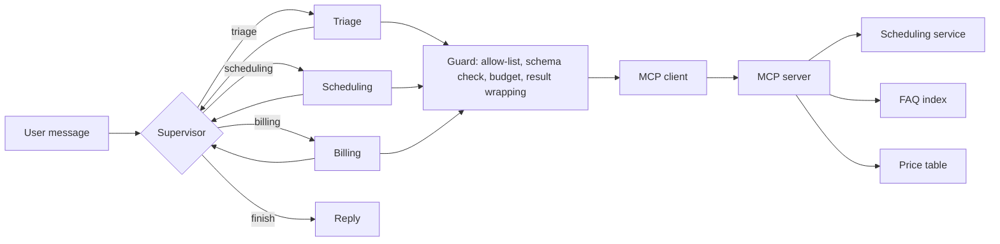

# mcp-multi-agent

A Model Context Protocol (MCP) server and a supervised multi-agent system that acts through it. The domain is a fictional veterinary clinic and all data is fictional.

> **Status:** the MCP server, the supervisor with three specialists, the tool guardrails and the evaluation harness with a CI gate are implemented and tested. The language model sits behind a small `ChatModel` protocol; this repository ships a scripted model for tests and a rule-based baseline for evaluation, and does not include an adapter for a hosted model yet.

## What it shows

- Business capabilities exposed as MCP tools with typed schemas, over stdio and streamable HTTP
- A client that discovers the tools dynamically and hands them to an agent
- A LangGraph supervisor that routes with a validated structured output to specialists (triage, scheduling, billing)
- Explicit hand-off rules: hop limit per turn, visit limit per specialist, specialists never talk to each other directly
- Guardrails: per-agent tool allow-lists, argument validation against each tool's JSON schema, argument size cap, a tool call budget per request, and tool results handled as untrusted data
- Per-session memory through a LangGraph checkpointer
- An evaluation harness over a labeled dataset, with a CI gate

## Architecture



The supervisor never calls tools. Each specialist only sees the tools in its allow-list, and every call goes through the guard before it reaches the MCP server.

| Specialist | Tools it may use |
|---|---|
| triage | `clinic_info`, `search_faq` |
| scheduling | `clinic_info`, `list_available_slots`, `book_appointment`, `reschedule_appointment`, `cancel_appointment` |
| billing | `get_price`, `search_faq` |

## Run it

```bash
python -m venv .venv && source .venv/bin/activate
pip install -e ".[dev]"
pytest
python -m mcp_multi_agent.demo
python -m mcp_multi_agent.evaluation
```

The demo runs four requests through the full graph and the real MCP server, printing the route, the tools used and the answer. It uses the rule-based baseline, so answers are raw tool output rather than natural language.

### The MCP server

```bash
python -m mcp_multi_agent.server
python -m mcp_multi_agent.server --transport streamable-http --port 8000
```

Inspect it with the [MCP Inspector](https://github.com/modelcontextprotocol/inspector):

```bash
npx @modelcontextprotocol/inspector python -m mcp_multi_agent.server
npx @modelcontextprotocol/inspector --cli python -m mcp_multi_agent.server --method tools/list
npx @modelcontextprotocol/inspector --cli python -m mcp_multi_agent.server \
  --method tools/call --tool-name clinic_info
```

The HTTP endpoint is `http://127.0.0.1:8000/mcp`. The FAQ tool uses a small BM25 index with light stemming over the documents in `src/mcp_multi_agent/data/faq`. It is lexical only: it matches words, not meaning.

Domain errors reach the client as MCP tool errors carrying a code and a message, for example `slot_unavailable: That slot is already taken.`

## Evaluation

`python -m mcp_multi_agent.evaluation` runs 30 labeled requests through the supervisor, the specialists and the MCP server, each against a fresh in-memory clinic. For every case it checks:

- **routing**: the first specialist chosen matches the label
- **tool use**: the expected tool was called, or no tool when none is expected
- **task completion**: the expected tool was called, the answer contains the expected fact, and errors appear only where the case expects one

The dataset is in `src/mcp_multi_agent/data/eval/routing_cases.jsonl` and includes ambiguous requests on purpose, such as a cancellation policy question that looks like a cancellation request, and requests outside the clinic's scope.

Results of the rule-based baseline:

| | Cases | Routing | Completion |
|---|---|---|---|
| triage | 10 | 80% | 70% |
| scheduling | 10 | 100% | 100% |
| billing | 7 | 100% | 100% |
| out of scope | 3 | 67% | 67% |
| **all** | **30** | **90%** | **86.7%** |

CI runs the evaluation with `--min-routing 0.85 --min-completion 0.80` and fails below those thresholds. What the gate protects is the harness, the dataset and the graph wiring: a change that breaks routing, hand-offs or tool plumbing drops the numbers. The baseline is a keyword router, so these figures say nothing about how a hosted model would do. The harness accepts any `ChatModel`, which is how a real model would be measured.

## Guardrails

| Control | Where | Tested by |
|---|---|---|
| Per-agent tool allow-list | `guard.check_call`, `team.run_specialist` | calls to a tool outside the list are refused |
| Argument validation against the tool's JSON schema | `guard.check_call` | wrong types, unknown enum values and missing fields are refused |
| Argument size cap | `guard.check_call` | oversized arguments are refused |
| Tool call budget per request, shared by all specialists | `team.build_team` | the third call with a budget of two is refused |
| Tool results wrapped as data, truncated, stripped of control characters | `guard.wrap_result` | a closing tag inside a result cannot break out of the wrapper |
| Instruction-like text in results is flagged | `guard.looks_like_injection` | a poisoned FAQ entry cannot cancel a booking |
| Hop limit and per-specialist visit limit | `team.build_team` | loops end with an explicit message |

Detecting injection phrases is a heuristic and is not the defense. The allow-list is: even if a model obeys text hidden in a tool result, it cannot call a tool its role does not have.

## Limits

- No adapter for a hosted model yet. The graph, the guard and the harness are model-agnostic.
- The scheduling data lives in memory and resets on restart.
- Retrieval is lexical.
- Per-session memory uses an in-memory checkpointer, so it does not survive a restart.

## Roadmap

- [x] 1. MCP server with scheduling tools and tests
- [x] 2. FAQ tool backed by retrieval
- [x] 3. Single agent using the MCP tools
- [x] 4. Supervisor and specialist agents
- [x] 5. Guardrails for tool use
- [x] 6. Evaluation and CI gates

## License

Released under the [MIT License](LICENSE).
